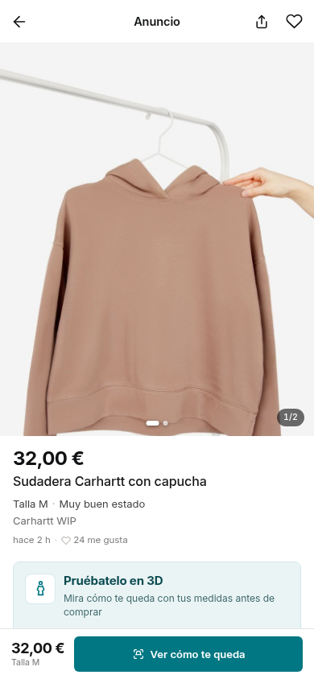
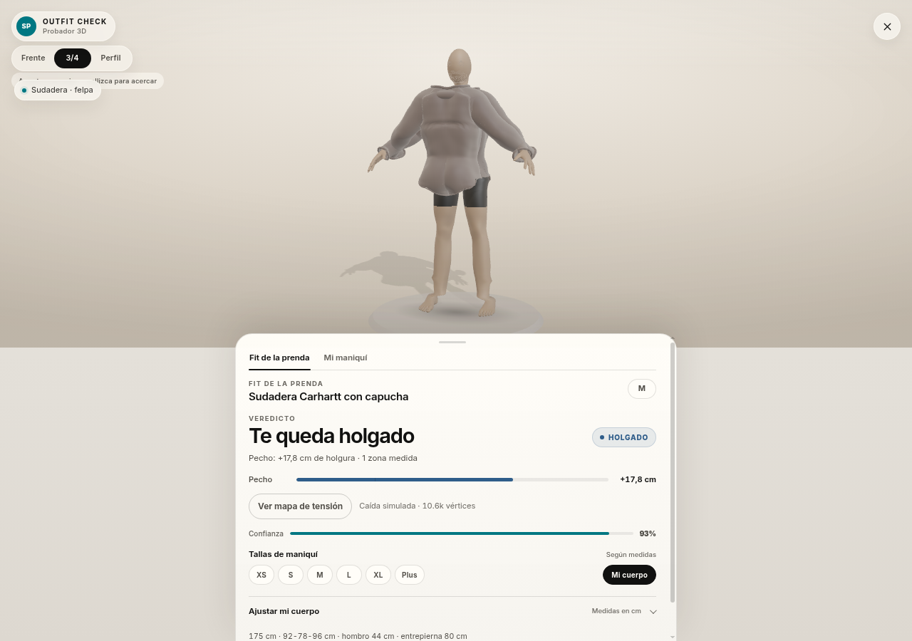

<div align="center">

# outfit check

**El probador 3D que Vinted no tiene.**
*Las medidas ya están en el anuncio. Nosotros las convertimos en un espejo.*

`Hackathon · 22/10/2026` · `4 horas` · `7 personas` · `0 backend` · `0 red` · `0 artistas 3D en el equipo`

[Demo](https://hack.cesura.duckdns.org/demo/vinted-mock/) · [Visor 3D](https://hack.cesura.duckdns.org/viewer/) · [Deck](https://hack.cesura.duckdns.org/deck/) · [Cómo funciona](#cómo-funciona) · [Historia](docs/HISTORY.md)

</div>

<div align="center">
  
  
</div>

<div align="center">
  <sub>Izquierda: el anuncio, con el CTA real. Derecha: el probador, con holgura por zona, veredicto y confianza. Capturas del prototipo, sin montaje.</sub>
</div>

---

## El problema, en una frase

En Vinted, si la prenda no te queda, **no hay devolución**: su política excluye los artículos que simplemente no encajan. En moda, entre el **53 % y el 67 %** de las devoluciones son por talla o ajuste. En C2C el error no cuesta un envío: cuesta la prenda entera, una disputa y un vendedor que pierde una estrella.

Y el dato para evitarlo **ya está en el anuncio**. El vendedor ya midió la prenda con una cinta. Lo que nadie hace es convertir esos centímetros en geometría.

**outfit check** lo hace: convierte las medidas planas de un listing en un maniquí paramétrico, genera la prenda en 3D y calcula la holgura por zona antes de pagar. Sin modelar la prenda a mano, sin subir fotos, sin backend.

> *"Vinted ya tiene las medidas. Tú ya tienes el cuerpo. Solo falta el espejo."*

---

## La experiencia

1. **Defines tu cuerpo una vez**: altura, pecho, cintura, cadera, hombro y entrepierna. Se guarda en tu dispositivo.
2. **Navegas el marketplace** como siempre.
3. **Abres un anuncio**. El CTA *Ver cómo te queda* está ahí, en la ficha.
4. **Ves la prenda sobre tu cuerpo**, con su tejido y su caída.
5. **Lees el veredicto**: *"Te queda bien de pecho. La cintura va 1,4 cm justa."* Con el número y la zona.
6. **Cambias de cuerpo o de talla** y el veredicto cambia en vivo. Es el momento que se recuerda.

---

## Qué es real (y qué no)

Este es el ledger canónico del proyecto. Si un claim no está aquí, no se dice en el escenario. La versión detallada, con evidencia y limitaciones, está en **[docs/CLAIMS.md](docs/CLAIMS.md)**.

| Claim | Estado | Evidencia |
|---|---|---|
| Cuerpo paramétrico desde 6 medidas + priors antropométricos | **REAL** | `packages/fit-engine/src/body.ts`, `body-profile.ts` |
| Validación de medidas, avisos y confianza del perfil | **REAL** | `resolveBodyProfile()`; UI de confianza |
| Deformación de una base mesh CC0 con los anillos del motor | **REAL** | `demo/vinted-mock/viewer3d/app.js` |
| Maniquí liso, sin cara, con ropa interior y presets XS–Plus | **REAL** | `viewer3d/app.js`; 2 GLB CC0 |
| Prenda 3D generada desde el cuerpo + medidas del listing | **REAL (WIP en acabados)** | `viewer3d/garment-builder.js`; 6 tipos |
| Materiales PBR por tejido (7 sets de texturas CC0, 21 mapas) | **REAL** | `viewer3d/assets/tex/`; recetas en `garment-builder.js` |
| Holgura por zona, veredicto y medidas que faltan | **REAL** | `computeFit()` en `viewer3d/app.js` |
| Mapa de tensión por zonas | **REAL (DEMO)** | `setHeatmap()`; color por zona, no por vértice |
| Maniquí personal persistente en el dispositivo | **REAL** | `localStorage`; clave `segunda-piel:personal-mannequin:v1` |
| 12 anuncios, 6 tipos de prenda, 7 tejidos | **REAL** | `demo/vinted-mock/data.js` |
| Demo offline, sin build y sin red en runtime | **REAL** | `serve.mjs`; Three.js vendorizado; fuentes locales |
| Extensión Chrome MV3 | **ROADMAP** | La demo usa iframe; no hay `apps/extension/` en este repo |
| Motor de fit completo en `packages/fit-engine/src/fit.ts` | **PARCIAL** | Contrato + cuerpo REAL; el fit de la demo es `fit-lite` |
| Orquestador LLM en vivo (Jev/OCR) | **ROADMAP** | Diseño y tipos en `docs/pipeline.md`; no en la demo |
| Medidas del cuerpo desde fotos | **ROADMAP** | Investigación en `docs/vision-extraction.md` |
| Simulación de tela real (XPBD/cloth sim) | **ROADMAP** | Hoy: relajación de distancias + gravedad + pliegues analíticos |
| Integración nativa en Vinted | **ROADMAP** | El mock reproduce la superficie; no hay API de Vinted |

**Regla dura:** una medida estimada nunca se presenta como declarada por el vendedor. En el pipeline diseñado, cada medida lleva `source` y `confidence`; en esta demo, las medidas del listing son declaradas y la confianza visible es la del fit.

---

## Cómo funciona

```
listing (medidas planas) ──┐
                           ├──► cuerpo paramétrico ──┐
tu perfil (6 medidas) ─────┘                         │
                                                     ├──► holgura por zona ──► veredicto
                           ┌──► prenda 3D ───────────┘
                           │
                    malla base CC0 + medidas
```

La idea matemática es una sola: **la prenda se deriva de la geometría del cuerpo y de las medidas del listing**. El cuerpo se resuelve con una pila de anillos; la prenda se recorta de esa superficie. La diferencia entre ambos es la holgura.

```
ease = contorno_prenda − contorno_cuerpo − 2π · grosor_tejido
```

- `ease < 0` → la prenda no cierra en esa zona.
- `ease` dentro de la banda del tipo de prenda → *regular*.
- `ease` por encima → *holgado*.
- El veredicto usa la zona crítica (la holgura más negativa), no un promedio.

Cada anillo es una **superelipse**:

```
x = rx · sign(cos t) · |cos t|^(2/n)
z = cz + rz · sign(sin t) · |sin t|^(2/n)
```

`n = 2` es una elipse; `n ≈ 2,4` es un torso; `n ≥ 3` es muy cuadrado. El cuerpo se resuelve desde circunferencias (`r = C / 2π`, corregido por profundidad y exponente); la prenda se recorta de la malla del cuerpo, se separa con la holgura del listing y se relaja con gravedad, restricciones de distancia y colisión contra el maniquí.

No hay una IA adivinando números. Hay geometría, aritmética y una decisión de producto: **el veredicto tiene que poder señalar la resta**.

→ Especificación completa: **[docs/ENGINE.md](docs/ENGINE.md)** · Arquitectura: **[docs/ARCHITECTURE.md](docs/ARCHITECTURE.md)**

---

## Las tres decisiones que lo hacen defendible

### 1. El LLM decide y explica. Nunca mide.

Un VLM generativo escribe `52 cm` con seguridad perfecta aunque no haya forma de medirlo. En una demo en vivo, eso es una ruleta. Por eso el pipeline separa responsabilidades: el LLM puede decidir qué herramienta llamar y traducir el resultado a una frase, pero **el número lo lee una herramienta y el veredicto lo calcula el motor**. Si el LLM falla, hay un `planDeterministic()` y plantillas. La demo no depende del modelo.

### 2. Cero assets por listing. Matemáticas.

Modelar 500 millones de anuncios de Vinted con artistas 3D es imposible. Nosotros no modelamos la prenda: la generamos a partir de sus medidas y de la malla del cuerpo. El coste marginal por listing tiende a cero y el sistema es auditable. La base mesh CC0 es infraestructura, no un catálogo: se deforma con *tus* medidas.

### 3. Todo on-device, todo offline.

No hay backend, no hay cuenta, no hay tracking, no se sube ninguna foto ni medida. El cuerpo vive en `localStorage`. La demo funciona sin red: Three.js, GLB, texturas, HDRI y fuentes están vendorizados. El día del jurado, el Wi-Fi no es un requisito.

---

## Historia: de la idea al deploy en cuatro horas

La crónica completa, con commits, pivotes y errores, está en **[docs/HISTORY.md](docs/HISTORY.md)**. Resumen:

| Hora | Qué pasó | Por qué importa |
|---|---|---|
| **13:06** | Repo creado | El reloj empieza |
| **13:49** | Plan de hackathon y reparto de 7 roles | Empezar por el problema y el contrato, no por el código |
| **14:11** | `types.ts` + `mock-body.ts` congelados | Dos personas pueden construir en paralelo sin pisarse |
| **14:21** | Primer mock de Vinted con botón y drawer | La demo ya tiene una superficie real |
| **14:31** | `sync-check.sh` y protocolo de sincronización | 3 ramas + 1 lead integrando cada 30–45 min |
| **15:14** | Home móvil con 12 anuncios + visor integrado | El producto se puede recorrer de punta a punta |
| **15:51** | Motor de cuerpo + base mesh CC0 | La geometría deja de ser un dibujo y se vuelve medida |
| **16:42** | Presets XS–Plus y ropa interior | El cuerpo se vuelve usable, no un experimento |
| **16:48** | Panel *Mi maniquí* | El cuerpo es del usuario y persiste |
| **17:13** | Prenda 3D + materiales PBR | El probador enseña ropa, no solo un maniquí |
| **17:29** | Últimos fixes de deck y viewer | Lo que se enseña es lo que funciona |

**Números del hackathon:** 44 commits · 157 archivos versionados al cierre · ~23 000 líneas propias de código (sin vendor) · 5 ramas · 12 anuncios · 6 tipos de prenda · 7 tejidos · 7 sets de texturas PBR (21 mapas) · 2 base meshes CC0 · 0 backend.

---

## Arrancar en local

No hay `npm install`, no hay build de frontend, no hay variables de entorno. Solo un servidor estático y un navegador con WebGL. El script de deploy copia estáticos; no compila la app.

### Demo completa (marketplace + probador)

```bash
node demo/vinted-mock/serve.mjs 8080
# http://localhost:8080/
# http://localhost:8080/viewer3d/?listing=carhartt-hoodie-m
```

Alternativa sin Node:

```bash
python3 -m http.server 8080
# http://localhost:8080/demo/vinted-mock/
```

### Deck + demo + visor desde el mismo origen

```bash
PORT=8080 ./deck/start.sh
# Deck:  http://localhost:8080/deck/
# Demo:  http://localhost:8080/demo/vinted-mock/
# Visor: http://localhost:8080/demo/vinted-mock/viewer3d/?listing=carhartt-hoodie-m
```

> El deck carga las slides con `fetch`: necesita HTTP, no `file://`.

### Build de los estáticos

```bash
./scripts/build-site.sh
# Resultado en dist/: index.html, landing.css, deck/, demo/, viewer/
```

---

## Estructura del repo

```
.
├── demo/vinted-mock/          # Marketplace mock + integración por iframe
│   ├── data.js                # 12 anuncios, 6 tipos, 7 tejidos
│   ├── app.js                 # Feed, ficha, filtros, favoritos, carrusel
│   ├── viewer.js              # Drawer, API FitViewer, handshake
│   └── viewer3d/              # Probador 3D
│       ├── app.js             # Escena, deformación, fit-lite, UI
│       ├── body-engine.js     # Bundle ESM del motor de cuerpo
│       ├── garment-builder.js # Prenda: recorte, holgura, solver, remates, PBR
│       └── assets/            # GLB CC0, HDRI, texturas, fuentes
├── packages/fit-engine/       # TS puro: contrato + cuerpo paramétrico
│   ├── src/types.ts           # Contrato congelado
│   ├── src/body.ts            # Perfil → landmarks → anillos → geometría
│   ├── src/body-profile.ts    # Priors, validación, confianza
│   ├── src/body-intent.ts     # Rasgos cualitativos → parámetros de forma
│   └── scripts/check-body.ts  # Verificación numérica del solver
├── deck/                      # Presentación 16:9 con la demo embebida
├── docs/                      # Documentación (empieza por docs/README.md)
├── scripts/                   # build-site.sh, sync-check.sh
├── deploy/                    # VPS, poller, previews por rama
├── .github/workflows/         # CI opcional de deploy
└── AGENTS.md                  # Contrato de colaboración del equipo
```

---

## Stack

| Capa | Elección | Por qué |
|---|---|---|
| Viewer | **JavaScript + Three.js r186** (vendorizado) | Sin build, sin framework, carga instantánea y control total del loft |
| Geometría | **BufferGeometry** construida a mano | Cuerpo y prenda se generan en el navegador; nada de Blender |
| Materiales | **MeshPhysicalMaterial** + HDRI + normal maps | Look de estudio con presupuesto de hackathon |
| Motor | **TypeScript puro** (`packages/fit-engine`) | Sin DOM, sin red, determinista y testeable |
| Integración | **iframe + postMessage** | Aísla CSS/CSP; no rompe la web anfitriona |
| Persistencia | **localStorage** | Privacidad on-device, cero backend |
| Deck | **HTML/CSS/JS estático** 1920×1080 | Control pixel-perfect y demo real embebida |
| Deploy | **GitHub + poller en VPS + previews por rama** | Cada push tiene URL; nadie toca el VPS a mano |

**Lo que no hay:** React, Vite, pnpm, backend, base de datos, CDN, API de Vinted, scraping en vivo.

---

## Documentación

| Documento | Qué responde |
|---|---|
| **[docs/README.md](docs/README.md)** | Mapa de la documentación y rutas de lectura |
| **[docs/JUDGE-GUIDE.md](docs/JUDGE-GUIDE.md)** | Recorrido de 5 minutos para el jurado, con qué mirar y qué preguntar |
| **[docs/MEMORIA.md](docs/MEMORIA.md)** | Resumen narrativo breve para el jurado |
| **[docs/CLAIMS.md](docs/CLAIMS.md)** | Ledger canónico REAL / DEMO / ROADMAP, con evidencia y límites |
| **[docs/HISTORY.md](docs/HISTORY.md)** | Crónica de las 4 horas: decisiones, pivotes, commits y aprendizajes |
| **[docs/ARCHITECTURE.md](docs/ARCHITECTURE.md)** | Sistema, capas, contratos, flujos, fallbacks y deuda técnica |
| **[docs/ENGINE.md](docs/ENGINE.md)** | Matemática del cuerpo, la prenda, el fit y el heatmap |
| **[docs/DECISIONS.md](docs/DECISIONS.md)** | 12 ADRs: contexto, decisión, alternativas y consecuencias |
| **[docs/QUALITY.md](docs/QUALITY.md)** | Qué se verificó, cómo reproducirlo y qué falta por probar |
| **[docs/PLAN.md](docs/PLAN.md)** | Plan original de la ventana de 4 h (documento histórico) |
| **[docs/pitch.md](docs/pitch.md)** | Guion de la presentación y Q&A |
| **[docs/STATS.md](docs/STATS.md)** | Cifras verificadas y fuentes para el pitch |
| **[docs/pipeline.md](docs/pipeline.md)** | Diseño del pipeline inteligente (LLM fuera del número) |
| **[docs/vision-extraction.md](docs/vision-extraction.md)** | Por qué la visión no puede medir cm sin escala |
| **[docs/agent-notes/](docs/agent-notes/README.md)** | Descubrimientos, trampas y atajos del equipo |
| **[packages/fit-engine/MANNEQUIN-PIPELINE.md](packages/fit-engine/MANNEQUIN-PIPELINE.md)** | Pipeline antropométrica del maniquí |
| **[demo/vinted-mock/README.md](demo/vinted-mock/README.md)** | Demo, API `FitViewer`, 12 anuncios y QA |
| **[demo/vinted-mock/viewer3d/README.md](demo/vinted-mock/viewer3d/README.md)** | Visor, controles, assets y límites |
| **[deck/README.md](deck/README.md)** | Estructura del deck, teclas y demo embebida |
| **[AGENTS.md](AGENTS.md)** | Contrato de colaboración, propiedad de archivos y sincronización |
| **[deploy/README.md](deploy/README.md)** | Deploy, previews y operación del VPS |

---

## Equipo y proceso

**7 personas en 4 horas:** 3 en implementación (geometría, fit/viewer, integración/demo) y 4 en presentación (narrativa/deck, vídeo, marca/UX, evidencia/Q&A).

El repo se organizó como un sistema, no como un chat:

- **Una carpeta, un dueño.** Nadie edita la carpeta de otra persona.
- **Contratos congelados a T+0:20.** `types.ts` es la frontera; si cambia, se avisa antes de tocarlo.
- **Una rama por persona.** El lead integra cada 30–45 minutos; nadie hace push directo a `main`.
- **`sync-check.sh`** devuelve códigos de salida (`0/10/20/30/40`) para que un agente sepa si seguir, rebasar o parar.
- **Auto-merge con revisor** para ramas `feat/*`: build + diff + revisión; `main` nunca se toca si falla.
- **Preview por rama** en cada push: la URL es lo que se comparte, no una captura local.
- **Ledger REAL/DEMO/ROADMAP** para que la presentación no prometa lo que el código no hace.

→ Detalle: **[AGENTS.md](AGENTS.md)** · **[docs/HISTORY.md](docs/HISTORY.md)**

---

## Límites conocidos

Un prototipo de 4 horas tiene aristas. Estas son las nuestras, dichas antes de que las pregunte el jurado:

- **El fit de la demo es `fit-lite`**: vive en `viewer3d/app.js`; el contrato y el motor de cuerpo están en `packages/fit-engine`, pero el `computeFit()` definitivo no llegó a `src/fit.ts`.
- **La prenda 3D está en WIP**: se recorta y se relaja, pero la sisa/cuello y el sombreado de la media malla espejada aún tienen costuras visibles. Ver `docs/agent-notes/cloth-viewer-wip.md`.
- **No hay cloth sim**: hay relajación de distancias, gravedad, colisión direccional y pliegues analíticos. Da caída; no es XPBD.
- **No hay visión en vivo**: Jev/OCR están documentados y tipados, no integrados. El mock usa medidas declaradas.
- **No hay extensión ni integración nativa**: la demo es un marketplace local con iframe.
- **El maniquí es abstracto**: sin cara, sin pelo, sin textura de piel. Es una decisión de producto y de privacidad, no un fallo.
- **El cuerpo no se escanea**: se construye con 6 medidas + priors. Los perfiles extremos pueden perder detalle.
- **Sin pruebas E2E automatizadas**: hay verificación numérica del motor y smoke tests manuales/headless; no hay suite Playwright en el repo.

---

## Créditos y licencias

- **Base meshes:** [Innerscene 3D Parts Library](https://www.innerscene.com/tools/library/3d-parts), adaptadas de MakeHuman, **CC0**. GLB de ~4,3 MB, 107 024 triángulos, 71 695 vértices, 163 huesos, A-pose.
- **Three.js r186:** licencia **MIT**; servido desde `demo/vinted-mock/viewer3d/vendor/`.
- **Texturas de tejido y HDRI:** **Poly Haven**, CC0; servidos desde `viewer3d/assets/`.
- **Fotos del mock:** **Pexels** y **Unsplash**, licencias libres; recortadas y recomprimidas. Ver `demo/vinted-mock/assets/CREDITS.md`.
- **Tipografías:** Instrument Serif, Inter y JetBrains Mono, servidas localmente en `deck/fonts/`.
- **Código:** prototipo de hackathon. No hay una licencia de producto publicada; consulta antes de reutilizarlo.

> **Aviso:** outfit check es un prototipo educativo. No está afiliado, patrocinado ni respaldado por Vinted. El marketplace, los vendedores, los precios y las fotos son un mock local para la demo.

---

<div align="center">

**Vinted ya tiene las medidas. Tú ya tienes el cuerpo. Solo falta el espejo.**

*Si tienes 5 minutos, empieza por **[docs/JUDGE-GUIDE.md](docs/JUDGE-GUIDE.md)**.*

</div>
