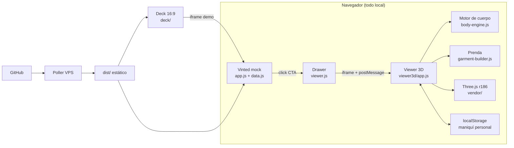
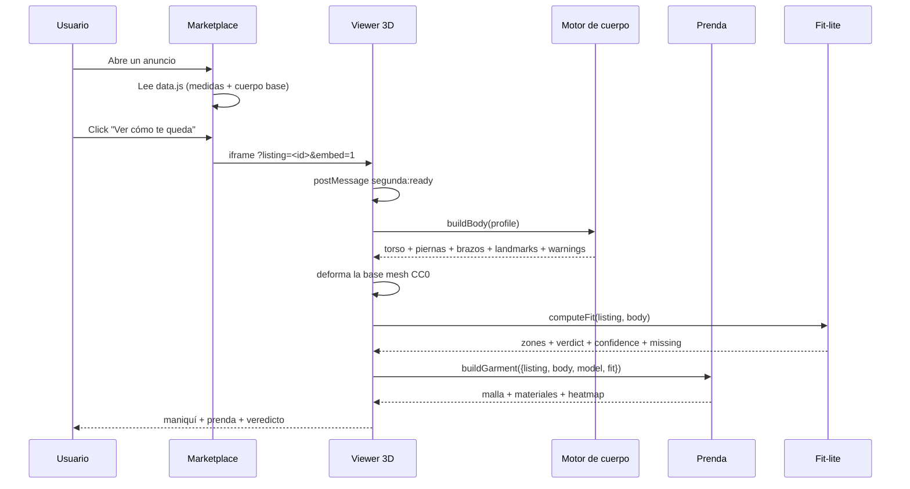

# Arquitectura — outfit check

> **Alcance.** Este documento describe el sistema que se ejecuta en la demo, no el sistema ideal. Donde hay una simplificación, se dice. Donde hay deuda técnica, se marca con prioridad.

---

## 1. Resumen en diez líneas

1. Todo corre en el navegador; no hay backend.
2. El marketplace es un mock local con 12 anuncios en `demo/vinted-mock/data.js`.
3. El visor 3D vive en `demo/vinted-mock/viewer3d/` y se abre en un iframe desde el drawer.
4. El motor de cuerpo es TypeScript puro en `packages/fit-engine/src/`; se bundlea a `viewer3d/body-engine.js`.
5. La malla base CC0 se deforma con los anillos y landmarks del motor.
6. La prenda se recorta de esa malla, se separa con la holgura del listing y se relaja con un solver de distancias.
7. El fit de la demo (`fit-lite`) calcula holgura por zona, veredicto, confianza y medidas faltantes.
8. La UI pinta veredicto, zonas, confianza, heatmap y panel "Mi maniquí".
9. El estado personal se guarda en `localStorage`; no se envía a ningún sitio.
10. El deploy es estático: GitHub → poller del VPS → `dist/`.

---

## 2. Principios de diseño

| Principio | Qué significa | Consecuencia |
|---|---|---|
| **Determinismo** | Misma entrada → misma geometría y mismo veredicto | Sin `Math.random`, sin red, sin LLM en el número |
| **Offline-first** | La demo funciona sin internet | Three.js, GLB, HDRI, texturas y fuentes vendorizados |
| **On-device** | El cuerpo no sale del navegador | `localStorage`, sin cuentas, sin analytics |
| **Contrato primero** | Las fronteras se congelan antes de implementar | `types.ts` + `mock-body.ts` desbloquean el paralelo |
| **Explicabilidad** | Cada veredicto tiene una resta detrás | `ease_cm`, zona crítica, fórmula visible |
| **Degradación** | Si falla una pieza, la demo sigue | Fallbacks de HDRI, texturas, prenda, iframe y storage |
| **Cero assets por listing** | No se modela ropa a mano | Prenda generada desde el cuerpo + medidas |
| **Honestidad** | Lo que no está, se etiqueta | Ledger `REAL` / `DEMO` / `ROADMAP` |

---

## 3. Contexto



**No hay flechas hacia una API.** Es deliberado: no hay servidor de aplicación, no hay base de datos, no hay autenticación y no hay llamadas a Vinted. El único estado persistente es el `localStorage` del navegador.

---

## 4. Capas y módulos

| Capa | Ruta | Responsabilidad | Runtime |
|---|---|---|---|
| **Contrato** | `packages/fit-engine/src/types.ts` | `Body`, `Ring`, `Garment`, `FitResult`, bandas, pesos de fuentes | TS puro |
| **Perfil** | `packages/fit-engine/src/body-profile.ts` | Priors, límites, validación, confianza | TS puro |
| **Intérprete** | `packages/fit-engine/src/body-intent.ts` | Rasgos cualitativos → parámetros de forma | TS puro |
| **Geometría** | `packages/fit-engine/src/body.ts` | Landmarks, anillos, piernas, brazos, cabeza, pies, manos | TS puro |
| **Bundle** | `demo/vinted-mock/viewer3d/body-engine.js` | `body.ts` + dependencias compiladas a ESM de navegador | JS |
| **Viewer** | `demo/vinted-mock/viewer3d/app.js` | Escena, GLB, deformación, fit-lite, UI, persistencia | JS + Three.js |
| **Prenda** | `demo/vinted-mock/viewer3d/garment-builder.js` | Recorte, holgura, solver, pliegues, remates, PBR, heatmap | JS + Three.js |
| **Marketplace** | `demo/vinted-mock/app.js` | Feed, ficha, filtros, búsqueda, favoritos, carrusel | JS |
| **Integración** | `demo/vinted-mock/viewer.js` | Drawer, API `FitViewer`, iframe, handshake, timeout | JS |
| **Deck** | `deck/` | Slides 1920×1080, demo embebida, focus, teclado | HTML/CSS/JS |
| **Build** | `scripts/build-site.sh` | Copia deck/demo/viewer, landing de `site/` y genera `dist/` con cache-busting | Bash |
| **Deploy** | `deploy/`, `.github/workflows/` | Poller, previews, releases, CI opcional | Infra |

### Lo que no existe (a propósito)

- `apps/viewer/` (React/R3F): se descartó por toolchain y peso.
- `apps/extension/`: la integración es iframe.
- `packages/fit-engine/src/fit.ts`: el fit de la demo es `fit-lite`.
- Backend, API, DB, auth, CDN.

---

## 5. Flujo principal



### Paso a paso, con los símbolos reales

1. **Entrada.** `readListing()` lee `?listing=<id>`; si no existe, usa el primer anuncio de `window.LISTINGS`; si no hay datos, `FALLBACK_LISTING`.
2. **Sexo.** `readListing()` infiere `male` / `female` / `neutral` desde `listing.category` (`hombre` / `mujer` / resto).
3. **Perfil.** `buildBody(profile)` llama a `resolveBodyProfile()`, calcula `computeTorsoLayout()`, construye torso, piernas, brazos, cuello, cabeza, pies y manos, y llama a `validateGeometry()`.
4. **Malla.** `loadModel(sex)` carga `assets/female-base.glb` o `male-base.glb`; `prepareModel()` indexa la geometría, los grupos de huesos y las tablas de deformación.
5. **Deformación.** `deform()` escala altura, anchura/profundidad del torso por anillo, piernas, muslos, hombros, brazos y cabeza; suaviza con Laplaciano y recalcula normales.
6. **Fit.** `computeFit(listing, body)` calcula `ease_cm` por zona, elige la zona crítica, clasifica el veredicto, estima `confidence` y lista `missing`.
7. **Prenda.** `buildGarment()` calcula `clearance`, recorta la superficie del cuerpo (`buildTopPatch()` o `buildPleatedPanel()`), relaja (`relax()`), añade pliegues (`addFabricFolds()`), remates y detalles, y espeja la media malla.
8. **UI.** `updateFit()` pinta veredicto, zonas, confianza y medidas faltantes; `updateGarmentStatus()` pinta tipo/tejido y vértices; `setHeatmap()` activa el mapa.
9. **Persistencia.** `savePersonalProfile()` guarda el perfil en `localStorage`; `loadSavedPersonalProfile()` lo recupera al arrancar.

### Reconstrucción y debounce

| Cambio | Qué se reconstruye | Mecanismo |
|---|---|---|
| Slider de cuerpo o preset | Cuerpo + prenda + veredicto | `scheduleDeform()` con `requestAnimationFrame`; `scheduleGarment()` con 150 ms de debounce |
| Cambio de anuncio | Se recarga el iframe con otro `?listing` | `readListing()` al arrancar; no hay swap in-place |
| Cambio de sexo | GLB, cuerpo, prenda | `loadModel()` + `deform()` + `rebuildGarment(true)` |
| Toggle heatmap | Solo visibilidad del mapa | `garment.setHeatmap(state.heatmap)` |
| Pestaña "Mi maniquí" | Nada 3D; solo UI | `setTab()` |
| Guardar maniquí | Nada 3D; solo persistencia | `localStorage.setItem()` |

**Por qué el debounce:** el solver de prenda recorre miles de vértices y decenas de iteraciones. Reconstruir en cada `input` de un slider bloquearía el hilo principal. El cuerpo se deforma en el siguiente frame; la prenda espera 150 ms a que el usuario suelte.

---

## 6. Contratos e invariantes

### 6.1. Unidades y ejes

```
Datos: cm
Escena: metros (cm × 0.01)
Y arriba · Z frontal · X derecha
Origen: suelo, entre los pies
```

La conversión se hace en una frontera: `cm()` en el motor y `CM = 0.01` en la prenda. La UI no hace `* 0.01` a mano.

### 6.2. Tipos principales

```ts
type Ring = { y: number; rx: number; rz: number; cz: number; n: number };

type Body = {
  height_cm: number; bust_cm: number; waist_cm: number; hips_cm: number;
  shoulder_cm: number; inseam_cm: number; arm_cm?: number;
};

type Garment = {
  type: 'tshirt' | 'hoodie' | 'dress' | 'jeans' | 'jacket' | 'skirt';
  fabric: 'cotton_jersey' | 'fleece' | 'denim' | 'knit' | 'linen' | 'leather' | 'satin';
  measurements: Record<string, number | undefined>;
  sources?: Partial<Record<string, MeasurementSource>>;
};

type FitResult = {
  verdict: 'too_small' | 'tight' | 'regular' | 'loose' | 'too_big';
  ease_cm: number;
  confidence: number;
  zones: FitZone[];
  missing: string[];
};
```


### 6.3. Invariantes que el motor verifica

- Altura en `[150, 210]` cm; el resto de medidas en `BODY_LIMITS`.
- Anillos del torso ordenados por `y` creciente.
- Radios `rx`, `rz` positivos.
- Circunferencia reproducida con tolerancia `max(0.5 cm, 0.5 %)`.
- Sin `NaN` en torso, piernas, brazos, cuello, cabeza, pies ni manos.
- Piernas y brazos con al menos 4 anillos.
- Perfil determinista: sin `Math.random`, sin red, sin DOM.

`validateGeometry()` lanza un error si algo se rompe; el viewer lo captura y muestra el panel de error con **Reintentar**.

### 6.4. Deriva conocida del contrato

El contrato `FitZone` incluye `tension`, pero el `fit-lite` de la demo no la calcula: devuelve `name`, `ease_cm`, `garment_cm`, `body_cm` y `verdict`. El heatmap usa el `verdict` de la zona, no una tensión por vértice. Es una simplificación consciente, documentada en [QUALITY](QUALITY.md) y [DECISIONS](DECISIONS.md).

---

## 7. Fallbacks y degradación

| Fallo | Detección | Respuesta |
|---|---|---|
| WebGL no disponible | `WebGLRenderer` puede lanzar | **Sin fallback 2D**; el visor no arranca. Es un límite conocido |
| GLB 404 / corrupto | `loadAsync()` rechaza | Panel de error + **Reintentar** |
| HDRI 404 | `RGBELoader` rechaza | `RoomEnvironment` como entorno de respaldo |
| Texturas de tejido 404 | `loadFabricTextures()` rechaza | Material PBR sin mapas; la prenda sigue |
| Prenda no construible | `buildGarment()` devuelve `null` o lanza | Se oculta la prenda, se muestra ropa interior y estado "Sin prenda 3D" |
| `localStorage` bloqueado | `try/catch` | La sesión sigue; no se persiste |
| Iframe no responde en 15 s | Timeout en `viewer.js` | Estado de estudio + **Reintentar** + **Abrir en pestaña** |
| Anuncio inexistente | `readListing()` | Primer anuncio o `FALLBACK_LISTING` |
| Medida faltante | `Number.isFinite()` | La zona se descarta; se muestra en `missing` |
| Ruta fuera del root del servidor | `filePath.startsWith(root)` | `403` |

**Principio:** la demo nunca se queda en blanco. Si el 3D falla, el deck y el marketplace siguen; si el iframe falla, el drawer ofrece una salida.

---

## 8. Privacidad y seguridad

### Lo que se cumple

- **Sin red en runtime.** No hay `fetch`, `XMLHttpRequest` ni CDN en el viewer.
- **Sin cookies, analytics ni tracking.**
- **Sin cuenta ni backend.** El cuerpo se queda en `localStorage`.
- **Sin fotos del usuario.** Solo medidas numéricas.
- **Iframe same-origin** en la demo; el CSS del marketplace no se filtra al viewer.

### Deuda y límites

- `postMessage({ type: 'segunda:ready' }, '*')` usa `'*'` como origen. En producción debe restringirse al origen del padre.
- `?viewer=<url>` permite apuntar el iframe a otro origen; es una comodidad de demo, no una superficie de producción.
- Varias vistas usan `innerHTML` con datos locales y controlados (`data.js`). Si en el futuro se consumen listings remotos, hace falta sanitizar.
- `serve.mjs` es un servidor de demo, no un servidor hardened: no tiene TLS, rate limiting ni cabeceras de seguridad.
- No hay CSP. En producción conviene una política que solo permita `'self'`, `data:` y los assets locales.

---

## 9. Rendimiento

### Presupuesto de diseño

| Recurso | Presupuesto | Realidad |
|---|---|---|
| FPS | 60 desktop / 30 móvil | No instrumentado; objetivo |
| Malla de la prenda | < 60k triángulos | Ejemplo Carhartt: ~10,6k vértices; ~21k triángulos |
| Iteraciones del solver | 18–20 | Fijo en `relax()` |
| Shadow map | 2048² | 1 luz con sombra |
| DPR | ≤ 2 | `Math.min(devicePixelRatio, 2)` |
| Reconstrucción de prenda | 150 ms debounce | `scheduleGarment()` |
| GLB | ~4,3 MB por base mesh | 107 024 triángulos, 71 695 vértices, 163 huesos |

### Lo que se hizo para que vaya fluido

- La geometría de la prenda se reconstruye solo cuando cambia la clave `listing + sexo + medidas + rasgos`.
- El cuerpo se deforma en un `requestAnimationFrame`, no en cada evento.
- El heatmap es una malla clonada con colores por vértice, no un shader costoso.
- El render loop es `setAnimationLoop` con `OrbitControls` y `autoRotate`; no hay postproceso.
- El HDRI se carga una vez y se reutiliza; si falla, `RoomEnvironment`.

### Lo que no se midió

- FPS reales en móviles de gama baja.
- Time to interactive con red lenta (el escenario es local/offline).
- Memoria en sesiones largas.
- Impacto de la media malla espejada en draw calls.

Está en [QUALITY](QUALITY.md) como deuda priorizada.

---

## 10. Cómo extenderlo

### Añadir un tipo de prenda

1. Añade el tipo a `GarmentType` en `packages/fit-engine/src/types.ts`.
2. Añade la banda de holgura a `EASE_BANDS`.
3. Añade el `case` en `computeFit()` y en `buildGarment()`.
4. Añade el label en `GARMENT_TYPE_LABEL`.
5. Añade al menos un listing en `data.js`.
6. Actualiza `docs/CLAIMS.md` y `docs/ENGINE.md`.

### Añadir un tejido

1. Añade el tejido a `Fabric`.
2. Añade `FABRIC_RECIPE` (roughness, sheen, normal, thickness).
3. Añade `FABRIC_TEXTURE` y las texturas a `viewer3d/assets/tex/`.
4. Añade el grosor a `FABRIC_THICKNESS_CM` en `app.js` y en `computeFit`.
5. Añade el label en `FABRIC_LABEL`.

### Reemplazar `fit-lite` por el motor completo

1. Implementa `computeFit()` en `packages/fit-engine/src/fit.ts` con el contrato `FitResult`.
2. Añade tests de mesa de holguras y de `confidence`.
3. Bundlea a `viewer3d/fit-engine.js` (o importa el módulo).
4. Sustituye la llamada local de `app.js` por el motor.
5. Elimina la duplicación de `FIT_BANDS` y `FABRIC_THICKNESS_CM` en el viewer.
6. Actualiza `CLAIMS.md` (de `PARCIAL` a `REAL`).

### Añadir el orquestador LLM

1. Respeta `Plan`, `PlanStep`, `PipelineTool` y `SOURCE_WEIGHT` de `types.ts`.
2. Implementa `planDeterministic()` **antes** que el LLM.
3. El LLM solo decide herramientas; nunca escribe una medida.
4. El explicador recibe el `FitResult` y no puede modificar `verdict`, `ease_cm` ni `confidence`.
5. Si el LLM tarda > 800 ms o falla, se usa el plan determinista y una plantilla.
6. Añade un test que compare el `FitResult` con y sin LLM: debe ser idéntico.

### Añadir un marketplace

1. Implementa un adaptador que normalice el listing al tipo `Listing`.
2. Mantén el contrato del iframe (`?listing=<id>&embed=1`) o pasa el listing por `postMessage`.
3. No metas scraping en vivo en la demo; precalcula.
4. Si el marketplace es remoto, sanitiza todo lo que vaya a `innerHTML`.

---

## 11. Deuda técnica priorizada

| Prioridad | Deuda | Impacto | Siguiente paso |
|---|---|---|---|
| **P0** | `fit-lite` no implementa el contrato completo (`tension`, `confidence_parts`) | El veredicto es correcto, pero el motor no es el definitivo | Implementar `fit.ts` y sustituir |
| **P0** | Sombreado de la media malla espejada | Costura visible en la prenda y el cuerpo | Recalcular normales/winding al espejar |
| **P1** | Copa de manga sin costura de sisa | El hombro parece neopreno | Añadir armhole seam y copa |
| **P1** | Cuello/puños/bajo son tubos sobre un borde escalonado | Acabado irregular | Suavizar el loop o construir un rib real |
| **P1** | `missing` solo cubre un subconjunto de medidas | La confianza puede ser optimista | Derivar `missing` de las medidas requeridas por tipo |
| **P2** | `postMessage` con origen `'*'` | Riesgo si se integra fuera del mock | Restringir a `location.origin` |
| **P2** | Sin tests E2E | Regresiones de UI no detectadas | Playwright con 3 flujos: feed → CTA → veredicto; preset; persistencia |
| **P2** | Sin medición de FPS/memoria | No se puede afirmar el rendimiento | Instrumentar `performance.now()` y un benchmark |
| **P3** | `serve.mjs` sin cabeceras de seguridad | Solo demo local | No exponer a internet; usar el build estático |

---

## 12. Mapa rápido de archivos

```
demo/vinted-mock/
├── index.html / styles.css        # Shell móvil + sistema visual
├── app.js                         # SPA: feed, ficha, filtros, favoritos
├── data.js / listings.json        # 12 anuncios
├── viewer.js / viewer.css         # Drawer + FitViewer API + handshake
└── viewer3d/
    ├── index.html / styles.css    # Shell del visor
    ├── app.js                     # Escena, deformación, fit-lite, UI
    ├── body-engine.js             # Bundle del motor de cuerpo
    ├── garment-builder.js         # Prenda + materiales + heatmap
    └── assets/                    # GLB, HDRI, texturas

packages/fit-engine/
├── src/types.ts                   # Contrato congelado
├── src/body-profile.ts            # Priors, límites, confianza
├── src/body-intent.ts             # Rasgos → forma
├── src/body.ts                    # Geometría paramétrica
└── scripts/check-body.ts          # Verificación numérica
```

---

## 13. Verificación rápida

```bash
# Sintaxis de todos los JS de la demo
for f in demo/vinted-mock/app.js demo/vinted-mock/data.js demo/vinted-mock/viewer.js; do
  node --check "$f"
done
node --input-type=module --check < demo/vinted-mock/viewer3d/app.js
node --input-type=module --check < demo/vinted-mock/viewer3d/garment-builder.js

# Motor de cuerpo
npx --yes tsx packages/fit-engine/scripts/check-body.ts

# Demo
node demo/vinted-mock/serve.mjs 8080
```

El detalle de qué se ejecutó, cuándo y con qué resultado está en [QUALITY](QUALITY.md).

---

<div align="center">
<sub>La arquitectura no es la más impresionante que se podría dibujar. Es la que se podía terminar, explicar y defender en cuatro horas.</sub>
</div>
